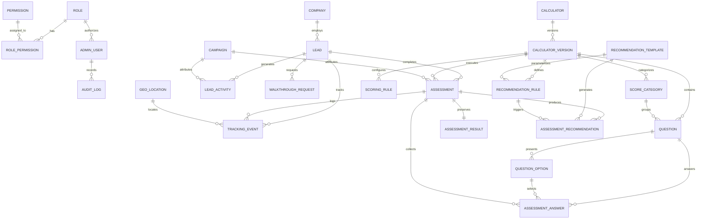

# GoSwiftHR Intelligence — Database Design & Schema Architecture

## 1. Overview & Architecture

The database layer of **GoSwiftHR Intelligence** is designed on PostgreSQL using Prisma ORM. It models four independent HR assessment calculators and a centralized lead intelligence engine while maintaining strict separation between presentation, calculation formulas, and client tracking.

The schema comprises 25 relational models organized into 7 cohesive functional domains:

1. **Access Control & RBAC**: `AdminUser`, `Role`, `Permission`, `RolePermission`
2. **Organizations & Leads**: `Company`, `Lead`
3. **Calculators & Versioning**: `Calculator`, `CalculatorVersion`, `ScoreCategory`, `Question`, `QuestionOption`, `ScoringRule`
4. **Recommendations Engine**: `RecommendationTemplate`, `RecommendationRule`, `AssessmentRecommendation`
5. **Assessments & Immutable History**: `Assessment`, `AssessmentAnswer`, `AssessmentResult`
6. **Analytics, Tracking & Campaigns**: `TrackingEvent`, `GeoLocation`, `Campaign`, `WalkthroughRequest`, `LeadActivity`
7. **Auditing, Integration & Alerts**: `IntegrationLog`, `AuditLog`, `Notification`

---

## 2. Entity-Relationship Diagram (ERD)

---

## 3. Core Architectural & Relational Rules

### A. Company Deduplication
- **Constraint**: `Company.normalizedName` has a `@unique` constraint.
- **Behavior**: When leads submit their company name (e.g. `"Acme Corp"`, `"acme corp "`, `"Acme Corp Ltd"`), the backend sanitizes and normalizes the name prior to lookup or creation. If a matching record or matching `domain` is found, the lead is linked to the existing company record, preventing duplicate records.

### B. Anonymous Sessions Prior to Lead Capture
- **Design**: `Assessment.leadId` is **nullable**.
- **Lifecycle**:
  1. A visitor starts a calculator anonymously. An assessment record is provisioned with a secure random `sessionToken`.
  2. The visitor answers questions (`AssessmentAnswer`), and interim results or calculations can be computed.
  3. When the visitor reaches the lead capture gate and submits contact information, the `lead` is created/upserted and linked to `Assessment.leadId`.
  4. If the user never completes the lead capture form, the assessment remains as an anonymous submission for aggregate statistical analysis without orphan foreign key violations.

### C. Independent Tracking Events
- **Design**: `TrackingEvent.leadId` and `TrackingEvent.assessmentId` are both **nullable**.
- **Lifecycle**: High-frequency web events (page views, button clicks, slider interactions) are tied to a persistent `visitorToken` and optional `GeoLocation`. They operate independently of whether a user ever creates a lead or starts an assessment.

### D. Calculator Versioning & Immutable Assessment History
- **Design**:
  - `CalculatorVersion` represents an immutable snapshot of an assessment definition (`versionNumber`, `questions`, `options`, `scoringRules`).
  - Active questionnaires never overwrite past questionnaire versions in place.
  - Completed assessments point directly to `calculatorVersionId`.
  - When completed, an `AssessmentResult` record is generated with `isImmutable: true` preserving category breakdown snapshots and computed metrics (`categoryScores: Json`, `calculatedMetrics: Json`).
  - Even if future versions of the calculator change weights or questions, historical respondent results remain 100% reproducible and verifiable.

### E. Source Recommendation Traceability
- **Design**: `AssessmentRecommendation` stores foreign keys to both `templateId` (`RecommendationTemplate`) and `ruleId` (`RecommendationRule`), but also creates a frozen copy of `title`, `summary`, and `actionPlan` as they existed at the exact moment the recommendation was generated.

---

## 4. The Four Independent Seeded Calculators

The database seed provides initial production configurations for the 4 core GoSwiftHR calculators:

| Calculator Slug | Display Name | Core Evaluation Domains |
| :--- | :--- | :--- |
| `hr-health-check` | **Workforce Health & Maturity Index** | Compliance, Talent Acquisition, Retention, HR Operations |
| `turnover-retention-calculator` | **Turnover & Attrition Cost Calculator** | Direct Replacement Cost, Ramp Time Productivity Loss, Institutional Knowledge Drain |
| `hr-tech-roi-calculator` | **HR Automation & Tech Stack ROI Calculator** | Manual Admin Time Loss, Multi-Vendor Point Solution Redundancy, Direct ROI |
| `compliance-risk-assessment` | **Employment Compliance & Risk Exposure Assessment** | Wage/Hour & Overtime, Contractor Misclassification, Mandatory Training Compliance |

---

## 5. Security & Privacy Safeguards

- **Credential Hashing**: Admin passwords use Node.js `crypto.scryptSync` with unique 16-byte random salts. Production passwords are never hardcoded and are read from environment variables or securely generated on seed.
- **Consent Auditing**: Leads record explicit boolean flags `consentGdpr`, `consentMarketing`, alongside exact timestamp `consentAt` and client IP `consentIp`.
- **Soft Deletion**: Sensitive entities (`AdminUser`, `Company`, `Lead`, `Calculator`, `Assessment`) include `deletedAt DateTime?` fields to preserve referential audit integrity when records are archived.
